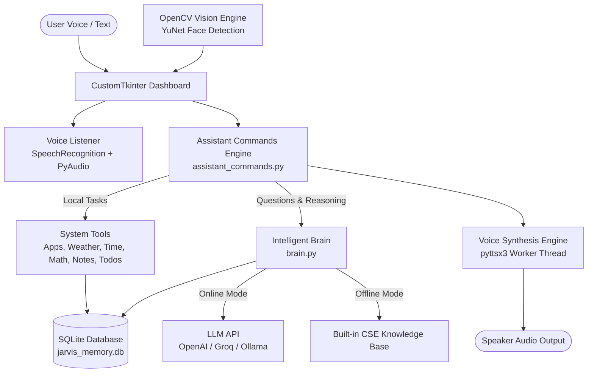

# ⚡ MINI JARVIS — Personal AI Voice Assistant

[](https://www.python.org/)
[](https://customtkinter.tomschimansky.com/)
[](https://opencv.org/)
[](https://www.sqlite.org/)

Inspired by Tony Stark's iconic **JARVIS** from *Iron Man*, **Mini Jarvis** is a fully functional, autonomous personal desktop AI assistant built in Python. It features voice recognition, natural speech synthesis, long-term memory, an intelligent reasoning brain, task automation, and a Stark Industries tactical HUD.

Designed specifically for **Computer Science & Engineering (CSE) students**, the codebase emphasizes clean modular architecture, security best practices (AST-based safe evaluation, thread-safe COM workers), and comprehensive documentation explaining *how* each component works under the hood.

---

## 📸 Futuristic Stark Industries Interface

- **Animated Arc Reactor**: Concentric energy rings pulse and rotate dynamically, changing color to reflect Jarvis's internal state (**Green** = Listening, **Gold** = Thinking, **Cyan** = Speaking, **Purple** = Vision Active).
- **Console HUD**: Futuristic conversation dialogue, quick prompt action chips, push-to-talk microphone, and continuous auto-listen toggle.
- **To-Do Hub**: Interactive checklist with status toggles and persistent database synchronization.
- **Notes Vault**: Fast note-taking system for saving thoughts, code ideas, and reminders.
- **Memory Log**: Persistent conversation history stored in SQLite, allowing review and history wiping.
- **Tactical Vision HUD**: Live webcam stream with deep-learning face detection (YuNet) and Stark targeting reticles.
- **Settings Panel**: Audio volume and speed sliders, voice selection (David / Zira), operator name customization, and LLM API setup.

---

## 🏛️ System Architecture



---

## 🧠 Core Computer Science Concepts Explained

### 1. Multithreading & Event-Driven GUI Programming
- **Problem**: In desktop apps, operations like speech synthesis (`pyttsx3.runAndWait()`), microphone listening (`recognizer.listen()`), and webcam streaming are **blocking I/O operations**. Running them on the main thread freezes the graphical interface.
- **Solution**: Mini Jarvis isolates blocking workloads into dedicated background daemon threads (`threading.Thread`). Inter-thread communication is coordinated using thread-safe queues (`queue.Queue`) and scheduled onto the Tkinter loop via `root.after()`.

### 2. Thread-Safe Windows COM Architecture
- On Windows, `pyttsx3` communicates with the native Microsoft SAPI5 speech engine via COM (Component Object Model). In multi-threaded Python, COM must be initialized within the specific thread driving the audio using `pythoncom.CoInitialize()`. Our `VoiceEngine` encapsulates this in a dedicated worker thread to eliminate audio overlap and COM deadlocks.

### 3. Safe Evaluation via Abstract Syntax Trees (AST)
- **Security Vulnerability**: Naive assistants use `eval(query)` to calculate math. This is a severe vulnerability (Remote Code Execution) because a user could pass malicious code like `eval("__import__('os').system('del /f /q ...')")`.
- **Solution**: In [`assistant_commands.py`](file:///c:/Users/USER/Desktop/Jarvis/Mini%20jarvis/assistant_commands.py), mathematical expressions are parsed into a syntax tree using Python's `ast` module. Only explicitly allowed binary operators (Add, Subtract, Multiply, Divide, Power) and numeric constants are traversed and executed.

### 4. Digital Signal Processing (DSP) for Voice Input
- Real-world microphones capture ambient room hum, keyboard clicks, and fan noise.
- `recognizer.adjust_for_ambient_noise(source, duration=0.4)` samples ambient background energy and dynamically adjusts the detection threshold so speech is cleanly captured without picking up background noise.

### 5. Relational Database Design & Persistent Memory
- Uses **SQLite3** (`jarvis_memory.db`) with relational tables:
  - `settings`: Key-value configuration store for preferred user name, speech speed, volume, and API keys.
  - `conversation_history`: Timestamped dialogue records providing multi-turn conversational context.
  - `todos`: Structured task list with boolean completion flags.
  - `notes`: Timestamped note repository.

### 6. Deep Learning Computer Vision (YuNet)
- Unlike traditional 20-year-old Haar cascades, Mini Jarvis integrates OpenCV's modern **YuNet ONNX model** (`FaceDetectorYN`), a fast, lightweight (~230KB) deep convolutional neural network for real-time face detection and landmark localization.

---

## 📁 File Structure

| File | Description |
| :--- | :--- |
| [`main.py`](file:///c:/Users/USER/Desktop/Jarvis/Mini%20jarvis/main.py) | Main application entry point (GUI and `--cli` modes) |
| [`ui.py`](file:///c:/Users/USER/Desktop/Jarvis/Mini%20jarvis/ui.py) | CustomTkinter Iron Man desktop dashboard & animated Arc Reactor |
| [`config.py`](file:///c:/Users/USER/Desktop/Jarvis/Mini%20jarvis/config.py) | Central configurations, colors, paths, and default settings |
| [`database.py`](file:///c:/Users/USER/Desktop/Jarvis/Mini%20jarvis/database.py) | SQLite3 memory manager for persistent user data |
| [`voice_engine.py`](file:///c:/Users/USER/Desktop/Jarvis/Mini%20jarvis/voice_engine.py) | Thread-safe Text-to-Speech (`pyttsx3`) worker queue |
| [`voice_listener.py`](file:///c:/Users/USER/Desktop/Jarvis/Mini%20jarvis/voice_listener.py) | Microphone capture & Speech-to-Text (`SpeechRecognition`) |
| [`brain.py`](file:///c:/Users/USER/Desktop/Jarvis/Mini%20jarvis/brain.py) | Dual-engine AI brain (LLM API + built-in offline CSE knowledge) |
| [`assistant_commands.py`](file:///c:/Users/USER/Desktop/Jarvis/Mini%20jarvis/assistant_commands.py) | Intent parser & system tools (Time, Apps, Math, Weather, Notes) |
| [`vision.py`](file:///c:/Users/USER/Desktop/Jarvis/Mini%20jarvis/vision.py) | OpenCV optical camera feed & tactical HUD face tracking |
| [`test_system.py`](file:///c:/Users/USER/Desktop/Jarvis/Mini%20jarvis/test_system.py) | Automated 7-point diagnostic test suite |
| [`requirements.txt`](file:///c:/Users/USER/Desktop/Jarvis/Mini%20jarvis/requirements.txt) | Python dependencies list |
| [`run.bat`](file:///c:/Users/USER/Desktop/Jarvis/Mini%20jarvis/run.bat) | Windows 1-click launch batch script |

---

## 🚀 Quick Start Guide

### 1. Requirements Check
- **OS**: Windows 10 or 11
- **Python**: 3.10+ (Tested & verified on Python 3.13)
- **Editor**: VS Code

### 2. Verify Diagnostic Health
Open a terminal in the project directory in VS Code and run:
```bash
python test_system.py
```
You will see all 7 subsystems report `[ OK ]`.

### 3. Launching Mini Jarvis
You can launch Mini Jarvis in two ways:

#### Option A: One-Click Windows Launcher
Double-click `run.bat` in the project folder.

#### Option B: From the Terminal / VS Code
```bash
python main.py
```

#### Option C: Headless Terminal Mode (CLI)
```bash
python main.py --cli
```

---

## 🎙️ Voice & Text Commands Cheat Sheet

Mini Jarvis recognizes commands spoken through the microphone or typed into the console:

### ⏱️ Time & Date
- *"What time is it?"*
- *"Tell me the current time."*
- *"What is today's date?"*
- *"What day is today?"*

### 💻 Applications & Web
- *"Open Notepad"* / *"Launch Calculator"* / *"Open Paint"*
- *"Open Task Manager"* / *"Open Command Prompt"*
- *"Open Chrome"*
- *"Search Google for quantum computing algorithms"*
- *"Search YouTube for lo-fi coding music"*
- *"Search Wikipedia for Alan Turing"*
- *"Open github.com"*

### 🧮 Mathematics (Safe AST Evaluator)
- *"Calculate 250 times 4"*
- *"What is 1500 divided by 12?"*
- *"Calculate 45 plus 82"*
- *"Evaluate 2 to the power of 8"*

### 📝 Notes Management
- *"Take a note: study graph traversal algorithms tomorrow"*
- *"Save note: buy milk and coffee beans"*
- *"Show my notes"* / *"Read my notes"*
- *(Or view, search, and delete directly in the Notes Vault tab!)*

### ✅ To-Do List Management
- *"Add to-do: finish operating systems lab assignment"*
- *"Add to my todo list: review dynamic programming"*
- *"Show my to-do list"*
- *(Or check off and manage directly in the To-Do Hub tab!)*

### 🌤️ Live Weather
- *"What is the weather today?"*
- *"Weather in London"*
- *"Weather forecast for New York"*

### 👤 Operator Profile & Memory
- *"Call me Tony Stark"*
- *"My name is Bruce"*
- *"What is my name?"* / *"Who am I?"*

### 🔋 Diagnostics
- *"System status"*
- *"Run diagnostics"*
- *"Check battery and CPU usage"*

### 🎓 Academic & CSE Concepts (Built-in + LLM)
- *"What is recursion?"*
- *"Explain binary search"*
- *"What are the four pillars of object-oriented programming?"*
- *"Explain time complexity and Big O notation"*
- *"What is an Operating System?"*
- *"How do I reverse a string in Python?"*

---

## 🔑 AI Brain Configuration (Optional)

Mini Jarvis comes with a **built-in offline knowledge base** that answers greetings, math, diagnostics, and computer science questions without any internet API.

To unlock open-ended reasoning (answering any general query or writing custom code), configure an API key:

### Using Free Groq API (Recommended for students!):
1. Sign up for a free key at [console.groq.com](https://console.groq.com).
2. Open Mini Jarvis and click the **Settings** tab.
3. Paste your Groq API key into the `API Key` field.
4. Set `Base URL` to: `https://api.groq.com/openai/v1`
5. Set `Model Identifier` to: `llama-3.3-70b-versatile`
6. Click **Save All Settings**.

### Using OpenAI:
1. Open the **Settings** tab.
2. Enter your OpenAI API key in `API Key`.
3. Leave `Base URL` blank (defaults to official OpenAI).
4. Set model to `gpt-4o-mini`.
5. Click **Save All Settings**.

### Using Local Ollama (100% Free & Offline):
1. Install [Ollama](https://ollama.ai) and run `ollama run llama3.2`.
2. In Settings, set `Base URL` to: `http://localhost:11434/v1`
3. Set `Model Identifier` to: `llama3.2`
4. Set `API Key` to `ollama`.

---

## 🛠️ Troubleshooting & Tips

- **Microphone Not Detecting Speech**:
  Ensure your microphone is enabled in Windows Settings -> Privacy & Security -> Microphone. You can also use the text input box at the bottom of the Console HUD at any time.
- **Voice Interruption**:
  If Jarvis is speaking and you need silence immediately, click the red **⏹ STOP** button on the console bar.
- **Camera Access**:
  Go to the **Tactical Vision** tab and click **Activate Optical Sensors**. If your laptop webcam is in use by another application (e.g. Zoom, Teams), close that application first.
